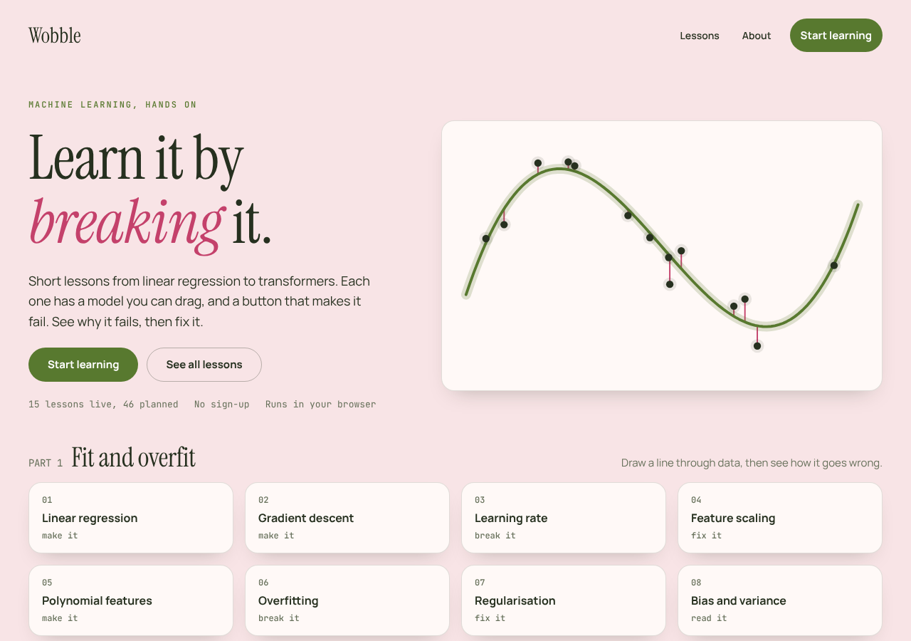
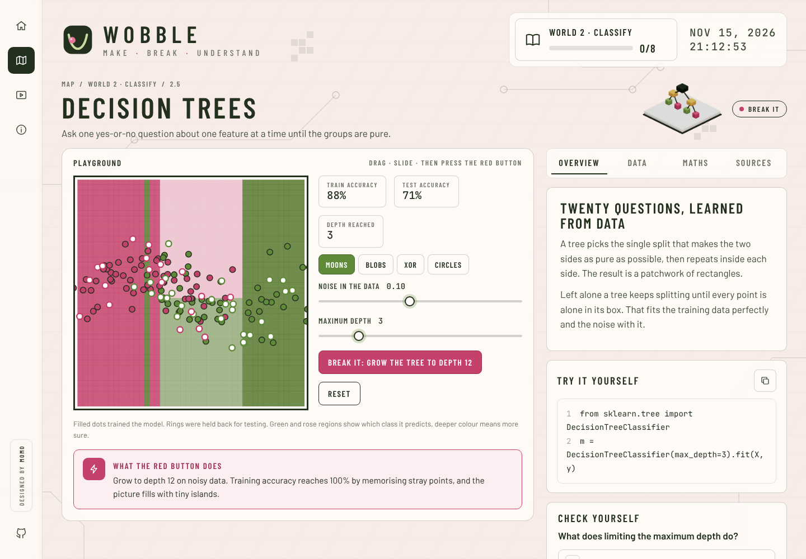
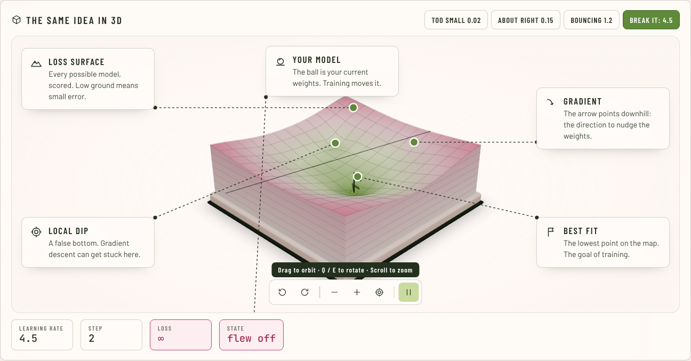

# Wobble

**Learn machine learning by breaking it.** 46 interactive lessons, from linear regression to diffusion, plus a 3D loss landscape you can spin, poke and send flying. Every lesson is a small model you can handle and a red button that makes it fail on purpose, because the way a model fails is where the idea becomes clear.



## What is in it

- **A 3D world.** The home page is a loss surface built in three.js. A ball rolls downhill by gradient descent, callouts are wired to points on the model, and you can edit the learning rate in the code card. Set it to 4.5 and the ball leaves the map. The same scene appears in the gradient descent, learning rate and optimiser lessons.
- **46 lessons in six worlds:** fit and overfit, classify, trust the score, find structure, neural networks, and advanced topics (time series, hidden Markov models, embeddings, attention, bandits and Q-learning, autoencoders, diffusion, interpretability, fairness). Each lesson has its own 3D object.
- **Every lesson has** a playground, a break-it button, an overview, the data, the maths (KaTeX), real library code to copy, sources, and one question that ticks the lesson off. Progress is saved in your browser only.
- **Checked, not guessed.** Each lesson was compared against several trusted sources before it was written. Where they disagree, the Sources tab says so, and the notes are in [`content/research/`](content/research/).
- **A tested engine.** Every model is written from scratch in TypeScript ([`lib/ml/`](lib/ml/)) and runs in the browser. 60 tests check it against scikit-learn, NumPy and SciPy, or against exact maths where no library applies.





## Run it

```bash
npm install
npm run dev        # http://localhost:3000
npm test           # 60 engine and content tests
npm run build      # static site in out/
```

Deploys as a static site (Next.js static export). `netlify.toml` is included: import the repo into Netlify and it builds `out/`.

To regenerate the scikit-learn fixtures: `python scripts/make_fixtures.py` (needs scikit-learn, NumPy, SciPy). To re-render the 46 lesson thumbnails: build, serve `out/` on port 8765, then `python scripts/make_thumbs.py` (needs Playwright).

## Stack

Next.js (App Router, static export) · TypeScript · three.js with React Three Fiber · KaTeX · Barlow and JetBrains Mono · Node's test runner.

## Accessibility

Keyboard reachable controls with visible focus, labelled sliders and buttons, tabs with arrow-key support, reduced-motion support, and the 3D scene has toolbar buttons for everything the mouse can do.

## Licence and author

© 2026 Muktanan Mohapatra (Momo). Released under the [MIT licence](LICENSE).

- Email: [muktamohapatra672@gmail.com](mailto:muktamohapatra672@gmail.com)
- GitHub: [github.com/tinySage](https://github.com/tinySage)

The datasets are small and made up so each lesson stays fast and readable. Results will shift on real data: use Wobble to build intuition, then test on your own problem.
