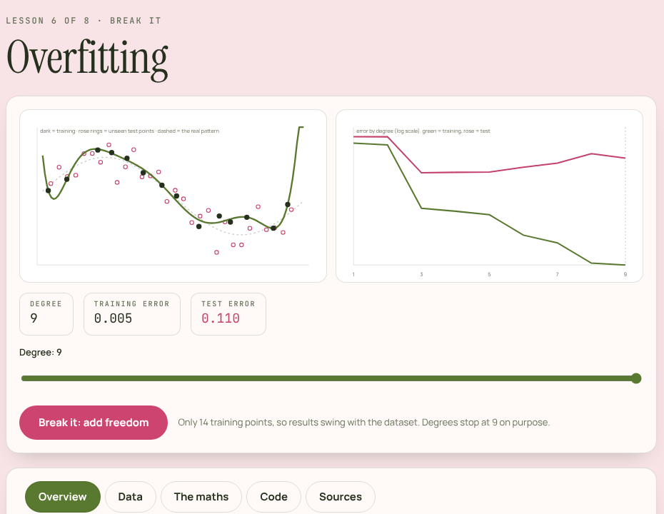
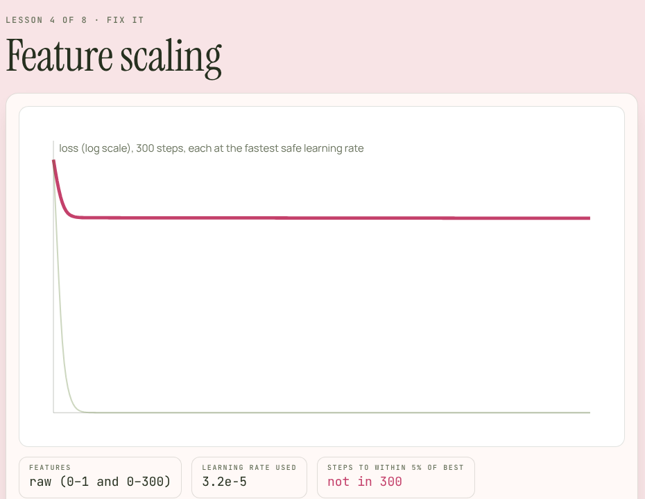
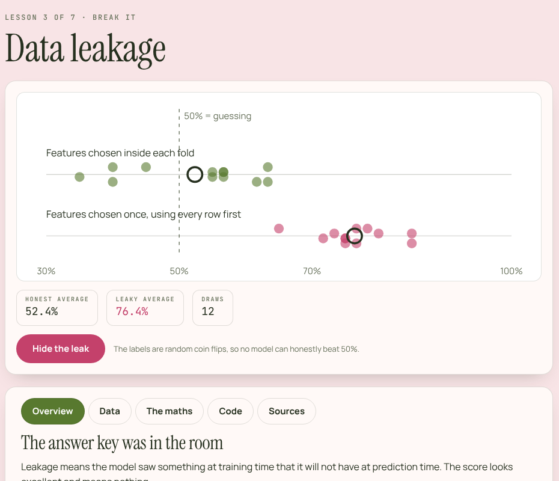

# Wobble

Learn machine learning by breaking it. Interactive lessons from linear regression to transformers: each one has a model you can drag and a button that makes it fail.

**Live lessons: 15** (Part 1 fit and overfit, Part 3 trust the score). Parts 2, 4, 5 and 6 are planned.


| Overfitting | Feature scaling | Leakage |
|---|---|---|
|  |  |  |

## What each lesson has
A live model, a **break it** button, tabs for overview, data, maths, code and sources, a check question and a real-life note. Sources and the differences found between them are in `content/research/`.

Progress is kept in your browser only (localStorage). There are no accounts and no tracking.

## Run it
```
npm install
npm run dev        # http://localhost:3000
npm test           # engine checked against scikit-learn, content checks
npm run build      # static export to out/
```
Deploy: import the repo into Netlify. `netlify.toml` sets the build command and `out` as the publish folder.

## How it was built
Stages, each reviewed as its own pull request: scaffold, ML engine, Part 1 lessons, Part 3 lessons, polish. `design/` holds the design canvas files the site is built from (blush and matcha).

Code is released under the [MIT License](LICENSE).

## The ML engine

`lib/ml/` is a small machine learning library written in TypeScript so every widget computes in your browser: least squares by Householder QR, ridge, lasso, polynomial fits, gradient descent, scaling, train/test and k-fold splits, walk-forward windows, classification metrics and L2 logistic regression.

It is checked against scikit-learn. `scripts/make_fixtures.py` writes reference numbers and `npm test` compares the engine to them. Time-ordered splits are also tested so that training never includes the future.

Known behaviour that the lessons account for: a high-degree polynomial on a few points can overfit by a huge and unstable margin, so the overfitting lesson caps the degree and uses a log scale for the error.
